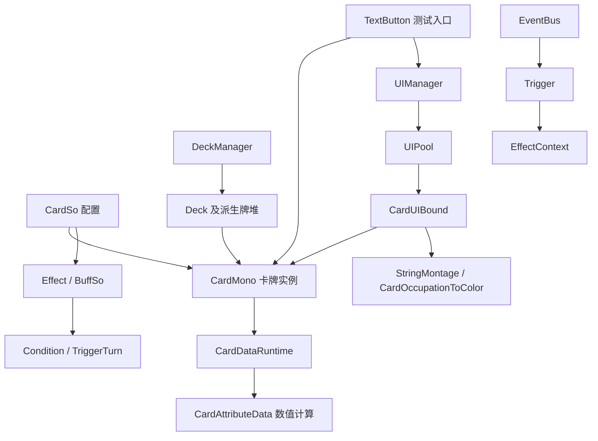

# GameSystem 结构分析

> 2026-11-28 源码快照。所有“已有实现”均指静态代码中存在对应逻辑，不表示已经通过编译或运行验证。

## 1. 目录与职责

```text
GameSystem/                         32 个 C# 文件，2 个 .tscn 场景
├─ BattleSystem/                     4 个 C#：战场数据、站位、回合占位
│  ├─ BattleScene/                   BattleSceneSO、BattleSceneMono
│  ├─ Enum/                         TriggerTurn（文件名 triggerturn.cs）
│  └─ Turn/Manager/                 TurnManager
├─ CardSystem/                       22 个 C#：卡牌、牌堆、效果与事件
│  ├─ Card/
│  │  ├─ Entity/                    CardAttributeData、CardDataRuntime
│  │  ├─ Enum/                      CardEnum.cs 中的 5 个枚举
│  │  ├─ Manager/                   CardManager
│  │  ├─ Mono/                      CardMono
│  │  └─ So/                        CardSo
│  ├─ Deck/
│  │  ├─ DeckData/                  Deck、DrawDeck、Hand、DiscardPile、SharePool
│  │  └─ Manager/                   DeckManager、BattleDeckManager、OutDeckManage
│  └─ Effect/
│     ├─ Condition/SO/              Condition（文件名 ConditionSO.cs）
│     ├─ EffectNameBound/           NameBound
│     ├─ impact/                    Effect、BuffSo
│     ├─ Trigger/                   Trigger
│     │  └─ Manager/                TriggerManager
│     ├─ EffectContext.cs
│     └─ EventBus.cs
├─ UISystem/                         3 个 C#：卡牌展示与对象池
│  ├─ UIBound/                      CardUIBound
│  ├─ UIManager/                    UIManager、UIPool
│  └─ UIScene/                      卡牌.tscn、Button.tscn
└─ Utils/                            3 个 C#：显示辅助与测试入口
   ├─ CardColor.cs                   CardOccupationToColor
   ├─ StringMontage.cs               StringMontage
   └─ Text/TextButton.cs             TextButton
```

各脚本旁的 `.cs.uid` 是 Godot 脚本标识文件，不是额外业务逻辑。目录中的 `Mono`、`So` 是现有命名；`CardMono` 实际继承 Godot `RefCounted`，并不是 Unity `MonoBehaviour`，`CardSo` 则是 Godot `Resource`。

## 2. 分层与依赖

现有代码可以按职责理解为四层，但尚未用程序集或接口强制隔离：

1. **配置层**：`CardSo`、`Effect`、`BuffSo`、`Condition`、`BattleSceneSO`，依赖 Godot 资源及导出字段。
2. **运行时数据与规则层**：`CardMono`、`CardDataRuntime`、`CardAttributeData`、牌堆类、事件类；其中部分仍继承 Godot 类型或直接依赖配置资源。
3. **协调层**：卡牌/牌堆管理器、UI 管理器及尚未完成的战斗/回合/触发器管理器。
4. **表现与输入层**：`CardUIBound`、`UIPool`、`TextButton` 和 `.tscn` 场景。



图中箭头表示使用或持有关系。`EventBus → Trigger → EffectContext` 是独立代码片段，尚未与出牌、效果配置或回合推进接通；`NameBound` 也没有被接入执行链路。

## 3. 卡牌配置与运行时数据

源目录：[`CardSystem/Card`](../../GameSystem/CardSystem/Card/)。

### CardSo：卡牌模板

继承 `Resource`，通过 `[Export]` 暴露私有字段。保存名称、图片、卡牌类型、职业、稀有度、费用、效果字典、描述片段，以及 `BattleOrManage`、`temp`、`CardClass` 标志，并提供 getter/setter。

- 效果数据结构为 `Godot.Collections.Dictionary<Effect, Array<float>>`，以效果资源对象为键，每个效果关联一组数值参数。
- 描述为 `Array<string>`，显示时交给 `StringMontage` 拼接。
- 没有独立卡牌 ID、参数命名、目标规则、费用支付规则、来源归属或使用后去向字段。
- `BattleOrManage`、`temp`、`CardClass` 在当前业务代码中未参与流转判断，其完整含义不能仅凭命名确定。

### CardMono：卡牌实例

继承 `RefCounted`，构造时保存模板引用并创建 `CardDataRuntime`。通过 `DataChanged` 事件通知视图刷新。提供费用修改、效果加法/乘法修正、基础值修改以及效果重置接口。

它是逻辑卡牌对象，不含场景坐标、输入或渲染逻辑。多个实例可共享同一个模板，运行时费用与效果数值分别保存。模板仍可通过 setter 改写，且没有模板变更通知。

### CardDataRuntime：单张牌的可变数据

保存当前费用与 `Dictionary<Effect, CardAttributeData>`。构造时从模板复制每个效果的数值列表，保留效果资源作为字典键；支持查询效果、全部重置和全部重算。

`ResetAllEffects()` 只重置效果数值，不重置费用。直接调用运行时数据的修改接口也不会自动触发 `CardMono.DataChanged`。

### CardAttributeData：效果数值计算

维护基础值、当前值、加法累计值和乘法累计值四组 `List<float>`。计算公式为：

```text
current[i] = (base[i] + additive[i]) × multiplier[i]
初始 additive[i] = 0，multiplier[i] = 1
```

`AddBonus` 累加加法修正，`MultiplyBonus` 连乘乘法修正；调用 `SetAllCurrent` 才重算。`Reset` 清空修正并恢复基础值，`SetAllBase` 只接受长度相同的列表。`GetCurrent` 直接返回内部可变列表。

### CardManager 与枚举

- `CardManager.CreateCard` 只是 `new CardMono(cardso)` 的静态包装，没有卡牌注册表或实例生命周期管理；测试按钮当前直接构造实例，没有调用它。
- `CardOccupation`：`warrior`、`ranger`、`caster`、`priest`。
- `CardType`：`normal`、`ability`、`Curse`。
- `Rarity`：`normal`、`rare`、`superrare`、`legendary`、`epic`。
- `CardEffect`：`drawCard`、`restorecost`、`damage`、`defense`、`restore`。
- `OutOrIn`：`Both`、`Out`、`In`、`Neither`。

枚举定义不代表相应卡牌或效果已经实现。

## 4. 牌堆与流转

源目录：[`CardSystem/Deck`](../../GameSystem/CardSystem/Deck/)。

- **Deck : RefCounted**：持有 `internal List<CardMono> cardList`；支持从列表末尾抽牌、添加、按索引删除和 Fisher–Yates 洗牌；随机数使用 Godot `RandomNumberGenerator`。私有 `BattleOrManage` 字段未被使用。
- **DrawDeck : Deck**：空派生类，没有独立抽牌规则。
- **Hand : Deck**：默认上限 10；`CheckHandHold` 在数量超限时移除并返回最后一张牌，未超限则返回 `null`。该方法没有调用方，容量限制并未统一生效。
- **DiscardPile : Deck**：声明私有 `Lock`、`Recycled` 列表，但没有读写接口或分区流转逻辑；继承的操作仍只访问 `cardList`。
- **SharePool : Deck**：空派生类，尚无公共容量、归属和允许流向的限制。
- **DeckManager : Node**：支持在两个牌堆间抽取/按索引转移、添加和删除。`deck1` 是接收方、`deck2` 是来源；接收方不是 `Hand` 时，每次转移后会洗牌。没有有效性、容量、同源同目标、卡牌归属或空值校验。
- **BattleDeckManager : DeckManager**：声明手牌、抽牌堆（字段名仍为 `_ManageDrawDeck`）、弃牌堆和公共池字段；生命周期方法为空。
- **OutDeckManage : DeckManager**：声明手牌、管理抽牌堆和战斗抽牌堆字段；生命周期方法为空。当前设计中的探索规则已不是传统抽牌流程，不能直接认定该管理器仍适用。

当前只有集合级操作，没有统一的 `PlayCard`、费用扣除、出牌去向、弃牌回收、战斗初始化/结束或牌堆变更通知。主场景没有挂载上述牌堆管理器。

## 5. 效果、条件与事件

源目录：[`CardSystem/Effect`](../../GameSystem/CardSystem/Effect/)。

- **Effect : Resource**：包含 `Condition`、`CardEffect` 和另一个 `Effect` 的引用；能描述关联关系，尚无执行方法、遍历顺序或循环引用检查。
- **BuffSo : Effect**：增加名称、图标、可叠加标志和最大层数；没有 Buff 运行时实例、当前层数、持续时间推进或移除逻辑。
- **Condition : Resource**：定义在 `ConditionSO.cs` 中，保存持续时间（注释约定 `-1` 为永久）与触发时机。未实现条件求值、次数累计或持续时间消耗。
- **EffectContext**：包含 `TriggerTurn trigger`、`object caster`、`List<object> Target` 和 `List<int> Value`。施法者/目标尚无业务类型，数值类型也与卡牌效果的 `float` 不同。
- **NameBound**：定义返回 `bool` 的 `EffectHandler(EffectContext)` 委托，以及 `CardEffect → EffectHandler` 的静态字典；字典为空，没有伤害、抽牌等处理函数。
- **Trigger**：保存触发时机、上下文和 `Action<EffectContext>`；调用时直接执行该委托。触发上下文是实例中保存的 `ctx`，不是 `EventBus.Invoke` 当次传入的数据。
- **EventBus**：按 `TriggerTurn` 保存触发器列表，支持订阅、退订和按时机遍历调用；没有发布方、生命周期归属或全局单例配置。
- **TriggerManager : Node**：空的 `_Ready`、`_Process`，没有把 `Effect/Condition` 转换为 `Trigger` 的逻辑。

`TriggerTurn` 位于 `BattleSystem/Enum/triggerturn.cs`，取值为 `nothing`、`turnend`、`turnstart`、`afterbattle`、`afterdraw`、`aftertakedamage`。效果模块依赖战斗模块中的此枚举，但没有系统实际发布这些事件。

效果系统目前是“配置结构 + 简单事件容器”，尚不是可结算的效果管线。`NameBound` 的返回值与 `Trigger` 使用的无返回值委托之间也未建立适配。

## 6. 战场与回合

源目录：[`BattleSystem`](../../GameSystem/BattleSystem/)。

- **BattleSceneSO : Resource**：计划记录玩家与敌人的初始位置，现有字段为两个私有 `List<object>`，尚无角色/站位数据类型。
- **BattleSceneMono : Node**：尝试读取配置位置、放置角色和交换玩家位置；配置引用没有初始化或导出，且存在缺失分号、私有字段跨类访问、变量大小写不一致及索引判断问题。具体问题见迁移清单。
- **TurnManager : Node**：只有空生命周期方法，没有回合状态机、行动方、回合计数或能量/抽牌时序。

没有角色实体、敌人行为、伤害/防御结算、胜负判定或战斗结果处理实现。主场景也没有挂载战场和回合节点。

## 7. UI 与辅助工具

源目录：[`UISystem`](../../GameSystem/UISystem/) 和 [`Utils`](../../GameSystem/Utils/)。

### CardUIBound : Control

通过导出引用绑定底色、名称、费用、图片、描述和类型控件。设置 `Data` 时先解除旧卡牌事件订阅，再订阅新卡牌，最后刷新；`_Ready` 也会刷新。

`Refresh` 要求节点已就绪且数据非空；名称、图片、职业颜色、类型和描述取自模板，费用取自运行时。当前描述没有使用效果运行时数值，所以效果修正虽能发出刷新通知，描述仍不会据此替换数字。

`CardClass` 控件实际显示 `GetCardType()`，并非模板中的 `OutOrIn CardClass`。代码没有 hover、选择、取消、确认使用或目标选择行为，也没有退出场景时解绑事件的逻辑。

### UIManager : Node 与 UIPool : Node

- `UIManager.CreateCard` 向池申请视图并绑定卡牌；`DeleteCard` 只将视图归还池，不删除逻辑卡牌或修改牌堆。
- `UIPool` 在 `_Ready` 预建 10 个 `CardUIBound`，以队列保存；申请时显示并启用物理处理，池空则扩容；归还时隐藏并禁用物理处理。
- 视图全部挂在池节点下，没有手牌容器布局。归还时不清空 `Data`、不解除事件、不重置位置，也不检查是否重复归还。

### 三个辅助类

- `CardOccupationToColor`（`CardColor.cs`）：将四种职业映射为红、绿、蓝、金色，未知枚举值返回灰色；使用 Godot `Color`。
- `StringMontage`：接受 Godot 字符串数组，将描述片段加上“。”拼接。但循环条件为 `i < Count - 1`，总会漏掉最后一项，单项数组显示为空。
- `TextButton : Button`：测试入口。按钮按下后检查模板和 UIManager 引用，创建卡牌并获取视图，再以 `(100 + n×40, 100 + n×40)` 依次偏移。它不向任何手牌或牌堆添加卡牌。

## 8. 实际入口、场景和配置资产

### 主场景引用

[`project.godot`](../../project.godot) → [`node_2d.tscn`](../../node_2d.tscn)：

```text
Node2D（实际类型为 Node）
├─ Manager（UIManager）       cardPool → ../Pool
├─ Pool（UIPool）             ItemScene → 卡牌.tscn
└─ Button（Button 场景实例）   TextButton
                             TestCard → SO/CardSO/Card1.tres
                             Manager → ../Manager
```

按配置与代码可追踪的调用链：

```text
TextButton.OnPressed
  → new CardMono(TestCard)
    → new CardDataRuntime(CardSo)
      → 为各效果创建 CardAttributeData
  → UIManager.CreateCard(card)
    → UIPool.Get()
    → CardUIBound.Data = card
      → 订阅 DataChanged，Refresh()
  → 设置 UI.Position
```

后续通过 `CardMono` 修改费用或效果数据时，`DataChanged → CardUIBound.Refresh`。主场景没有演示该修改，也没有接入抽牌、出牌或效果结算。

### GameSystem 内的场景

- [`卡牌.tscn`](../../GameSystem/UISystem/UIScene/卡牌.tscn)：`Control → Panel → ColorRect` 下配置文字与图片，显示区域主要为 90×120；使用根目录 `icon.svg`。另有隐藏 Button，没有连接交互脚本。
- [`Button.tscn`](../../GameSystem/UISystem/UIScene/Button.tscn)：显示“点”的测试按钮，脚本在主场景实例上挂载。

### GameSystem 外的相关文件

- [`SO/CardSO/Card1.tres`](../../SO/CardSO/Card1.tres)：当前测试卡，名称“哈哈”、费用 1、描述只有“我是”，效果字典为空，图片使用 `icon.svg`。单项描述会受 `StringMontage` 缺陷影响。
- [`SO/EffectSO/Buff/buff1.tres`](../../SO/EffectSO/Buff/buff1.tres)：仅绑定 `BuffSo` 脚本，没有配置具体效果数据；主场景和测试卡未引用它。
- 根目录 [`Button.tscn`](../../Button.tscn)：另一份简单按钮场景，本次检查的主场景引用链没有使用它。
- `icon.svg`、`.import`、`.uid`、Godot 工程文件和根目录主场景也是后续迁移/清理需要核对的边界，不能只处理 `GameSystem`。

## 9. 能力边界

已有代码：卡牌模板与运行时副本、效果数值修正、费用修改、数据变更事件、牌堆基本操作、卡牌显示、UI 对象池和测试按钮。

声明但未形成业务流程：弃牌分区、公共池、效果条件、Buff、事件触发、战场站位、回合推进、战斗/探索牌堆管理。

尚未发现对应实现：角色选择与初始化、手牌选择器、出牌事务、目标校验、能量支付、效果执行、奖励、天赋、装备、地图/节点推进、保存加载及三关 Demo。相关需求文档应作为后续开发输入，不能计入已有迁移成果。
